# Design Document

**Project:** Green Software Metrics Framework (GSMF)
**Course:** BIL 481 Software Engineering, Fall 2026
**Group:** Intellectual Property
**Document date:** 15-11-2026

## List of Contributors

| Name | GitHub | School Number |
|---|---|---|
| Reşat Efe Koca | @djkurbaga | 231301010 |
| Bülent Çakır | @BulentCakirr | 231301064 |
| Murat Yılmaz | @yilmazmurat06 | 241101063 |
| Furkan Yaman | @furkany22 | 221301015 |

Individual contributions are listed in the [Task Matrix](#5-task-matrix).

## Table of Contents

1. [System Overview](#1-system-overview)
   1. [Description](#11-description)
   2. [System Architecture](#12-system-architecture)
   3. [Technology Stack](#13-technology-stack)
2. [Implementation Details](#2-implementation-details)
   1. [Codebase Structure](#21-codebase-structure)
   2. [Key Implementations and Core Logic](#22-key-implementations-and-core-logic)
   3. [Component Interfaces](#23-component-interfaces)
   4. [Visual Interfaces](#24-visual-interfaces)
3. [Use Case Support](#3-use-case-support)
   1. [Selection and Requirement Mapping](#31-selection-and-requirement-mapping)
   2. [UC1 — Configure Benchmark](#32-uc1--configure-benchmark-fr-1)
   3. [UC2 — Manage Isolated Stack Lifecycle](#33-uc2--manage-isolated-stack-lifecycle-fr-3)
   4. [UC3 — Compute Efficiency Metrics](#34-uc3--compute-efficiency-metrics-fr-8)
   5. [UC4 — Persist and Export Results](#35-uc4--persist-and-export-results-fr-11)
   6. [One Full Repetition](#36-one-full-repetition)
4. [Design Decisions](#4-design-decisions)
   1. [Technology Comparisons](#41-technology-comparisons)
   2. [Justification of Choices](#42-justification-of-choices)
5. [Task Matrix](#5-task-matrix)

<div style="page-break-after: always;"></div>

## 1 System Overview

### 1.1 Description

GSMF is a Python command-line framework for measuring the energy efficiency of the same reference CRUD application on two self-hosted low-code platforms (Budibase and Appsmith, run in Docker) and on a hand-coded FastAPI baseline. The full system will start one platform stack at a time, measure idle and workload energy from Linux RAPL counters while a separate machine drives a k6 workload, and report energy per completed user task, Energy-Delay Product (EDP) and operational SCI ([requirements.md](requirements.md)).

This document covers the four use cases implemented for Assignment 2: loading and validating a benchmark configuration (UC1, FR-1), starting, health-checking and stopping one isolated Docker Compose stack (UC2, FR-3), computing efficiency metrics for valid repetitions (UC3, FR-8), and storing every repetition in SQLite with CSV export (UC4, FR-11). The benchmark runner, RAPL reader, k6 client, statistics/SCI and the dashboard (FR-2, FR-4 – FR-7, FR-9, FR-10, FR-12 – FR-14) are not implemented yet; they appear in the diagrams as planned components only.

### 1.2 System Architecture

GSMF uses a layered architecture. The **presentation layer** is the CLI. The **service layer** contains one module per use case (`config`, `lifecycle`, `metrics`), plus the planned runner, measurement and workload modules. The **storage and infrastructure layer** contains the `storage` module with its SQLite database and CSV files, and the external systems: the YAML file, Docker Engine, Linux RAPL and the k6 load generator. Every module exchanges data only through the shared types in `gsmf/models.py`, so no service module depends on another module's internals.

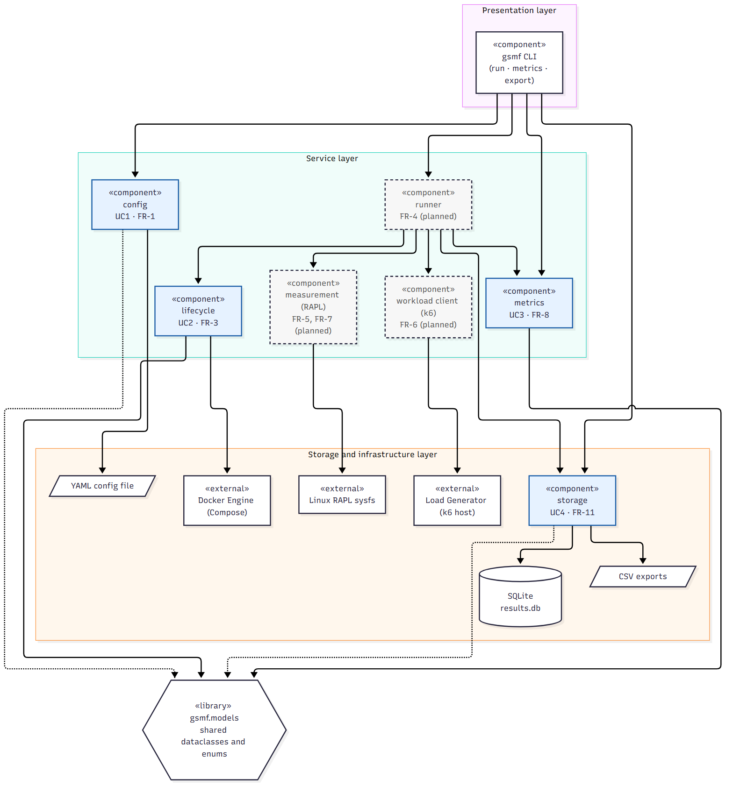

*Figure 1. Component diagram. Blue components are implemented (UC1–UC4); dashed grey components are planned.*

### 1.3 Technology Stack

| Layer | Technology | Version in repository | Used for |
|---|---|---|---|
| Language | Python | 3.11 target (`python:3.11-slim` baseline image); tests recorded on 3.12–3.14 | All GSMF modules |
| Configuration | YAML via PyYAML | `PyYAML>=6.0,<7` | UC1 config file (`yaml.safe_load`) |
| Container orchestration | Docker Engine + Docker Compose CLI, called via `subprocess` | Compose 5.1.4 / Engine 29.4.3 in the recorded comparison | UC2 stack lifecycle |
| Health probing | Python standard library `urllib` in a child process | — | UC2 HTTP health check (`gsmf/health.py`) |
| Storage | SQLite (Python `sqlite3`) | SQLite 3.53.1 in the recorded comparison | UC4 result store |
| Export | CSV (Python `csv`) | — | UC4 raw and aggregate export, UC3 demo input |
| Reference baseline | FastAPI + Uvicorn in Docker | `fastapi==0.163.1`, `uvicorn==0.54.0` | UC2 demo target (`apps/fastapi-baseline/`) |
| Testing | pytest; HTTPX for the FastAPI test client | `pytest>=8.0`, `httpx>=0.28,<1` | 307 automated tests |
| Comparison only | Pydantic, Docker SDK for Python | `pydantic==2.13.4`, `docker==7.2.0` | `comparisons/` scripts; not used by GSMF itself |
| Diagrams | Mermaid (`@mermaid-js/mermaid-cli`) | — | `docs/diagrams/*.mmd` → PNG |

Planned and not yet in the code: Linux RAPL sysfs reader, k6 on a separate host, and the web dashboard.

<div style="page-break-after: always;"></div>

## 2 Implementation Details

### 2.1 Codebase Structure

```text
gsmf/                         GSMF package
  __init__.py                 package version (0.1.0)
  models.py                   shared enums, frozen dataclasses, unit labels, exceptions
  config.py                   UC1  load_config / validate_config (FR-1)
  lifecycle.py                UC2  StackManager, isolated_stack (FR-3)
  health.py                   UC2  bounded HTTP health probe in a child process
  metrics.py                  UC3  energy per task, EDP, CSV loader, CLI (FR-8)
  storage.py                  UC4  ResultStore: SQLite schema, insert-only writes, CSV export (FR-11)
apps/fastapi-baseline/        FastAPI baseline: GET /health, Dockerfile with HEALTHCHECK, docker-compose.yml
examples/
  benchmark.yaml              example UC1 configuration (one FastAPI target)
  sample_measurements.csv     illustrative sample repetitions, not real measurements
comparisons/                  technology comparison scripts and their recorded outputs (results/)
tests/                        pytest suite (307 tests)
docs/diagrams/                Mermaid sources and PNGs (source of truth for UML)
docs/wireframes/              SVG/PNG wireframes of the CLI, CSV export and dashboard
.github/ISSUE_TEMPLATE/       bug report template used by the QA plan
```

| Test file | Tests | Covers |
|---|---:|---|
| `tests/test_config.py` | 19 | UC1 valid targets, defaults, missing/invalid fields, YAML errors, relative paths |
| `tests/test_lifecycle.py` | 23 | UC2 state transitions, Compose calls, startup/health/shutdown failures, cleanup |
| `tests/test_health_deadline.py` | 5 | UC2 total HTTP health deadline against a real local server |
| `tests/test_fastapi_baseline.py` | 2 | Baseline `/health` contract and example config |
| `tests/test_metrics.py` | 16 | UC3 formulas, skipped records, zero tasks, units, CSV, CLI |
| `tests/test_storage.py` | 34 | UC4 schema, insert-only rules, triggers, metrics checks, CSV export |
| `tests/test_*_comparison.py` | 9 | The three comparison scripts |

Test functions are counted above; parametrized cases expand them to 307 collected tests.

### 2.2 Key Implementations and Core Logic

**Shared contract (`gsmf/models.py`).** All data passed between modules is a frozen dataclass (`TargetPlatform`, `BenchmarkConfig`, `TestbedSettings`, `RepetitionRecord`, `EfficiencyMetrics`), so a value cannot be changed after it is created. Three enums define the allowed values: `PlatformKind` (`budibase`, `appsmith`, `fastapi`), `StackState` (`starting`, `healthy`, `running`, `stopping`, `stopped`, `failed`) and `RepetitionStatus` (`valid`, `invalid`, `failed`). Field names carry their unit (`_j`, `_s`, `_w`, `_js`), and the unit labels `J/task` and `J·s` are module constants. Errors share the base class `GSMFError` with `ConfigError` (UC1), `ExecutionFailure` (UC2) and `StorageError` (UC4).

**UC1 — validation (`gsmf/config.py`).** `load_config` reads the file with `yaml.safe_load` and turns read, decode and YAML errors into `ConfigError`. `validate_config` checks the rules of FR-1 in order and stops at the first violation with a message that names the field, for example `targets[0].kind: desteklenmeyen hedef 'bubble'; desteklenenler: budibase, appsmith, fastapi`. Counts must be `int` (booleans and strings are rejected) and positive; `cooldown_s` and `grid_carbon_intensity` must be finite and non-negative; `health_timeout_s` (default 120) must be finite and positive; `base_url` and `health_url` must be absolute HTTP(S) URLs with a valid port. After validation, `load_config` resolves relative `compose_file` paths against the YAML file's directory. No stack is started during UC1.

**UC2 — lifecycle (`gsmf/lifecycle.py`, `gsmf/health.py`).** `StackManager` runs `docker compose -f <file> …` as an argument list (no shell) with a finite timeout (`command_timeout_s`, default 120 s). The command runner is the attribute `runner` (default `subprocess.run`), so tests can inject fake Compose responses without changing the method signatures. The manager owns one target at a time:

- `start` refuses a new target unless the previous one was confirmed `STOPPED`, then runs `up -d`.
- `wait_until_healthy` polls `ps --all --format json` until every container is `running` (and `healthy` if it has a health check), then requires an HTTP 2xx from `health_url`, all before one deadline. Exited, dead or unhealthy containers fail immediately.
- `http_status` runs each probe in a separate Python process that is killed when the remaining time ends. This bounds DNS lookup, redirects and slow headers together.
- `stop` runs `down --remove-orphans` and then `ps --all --quiet`. The stack is `STOPPED` only if no container IDs remain; otherwise the state stays `FAILED` and the next `start` is blocked.
- `isolated_stack` is a context manager that always calls `stop` on exit, including after startup, health or workload errors.

**UC3 — metrics (`gsmf/metrics.py`).** For each record, `skip_reason` returns why no metric may be computed: the status is not `VALID`, net energy or duration is missing or not finite, `completed_tasks` is missing or ≤ 0, net energy is negative, or the duration is not positive. Otherwise `compute_repetition_metrics` creates a new `EfficiencyMetrics` with `energy_per_task_j = net_energy_j / completed_tasks` and `edp_js = net_energy_j × duration_s`. The low-level functions `energy_per_task` and `energy_delay_product` raise `ValueError` on zero tasks or a non-positive duration, so a division by zero cannot happen even if they are called directly. The input record is never modified.

**UC4 — persistence (`gsmf/storage.py`).** `ResultStore` opens a short-lived connection per operation with foreign keys enabled and one transaction (commit on success, rollback on error); all SQLite errors become `StorageError`. The schema has four tables: `runs` (configuration columns, full config as JSON, testbed settings), `run_targets` (one row per configured target with its version), `repetitions` (every record, `UNIQUE (run_id, target, repetition_index)`, and a `CHECK` that INVALID/FAILED rows have a non-empty `reason`) and `metrics` (separate from raw data, with a foreign key to its repetition). The store only inserts. `initialize_schema` also creates `BEFORE UPDATE` and `BEFORE DELETE` triggers on all four tables that abort with `… kayıtları değiştirilemez (FR-11)`, so even direct SQL cannot change stored values. Further checks:

- A repetition is rejected if its run was not saved or its target is not in that run's configuration.
- NaN is rejected, because SQLite would silently store it as NULL.
- Metrics are accepted only for a stored `VALID` repetition whose net energy, duration and task count match.

`export_raw_csv` writes every repetition, and `export_aggregates_csv` writes one row per target with valid/invalid/failed counts and mean, median, sample standard deviation, minimum and maximum of the stored metrics. Confidence intervals belong to FR-9 and are not computed here.

### 2.3 Component Interfaces

The class diagram shows the exact signatures from the code. The implemented modules keep the signatures that were committed as stubs before implementation started (commit `8c234f0`).

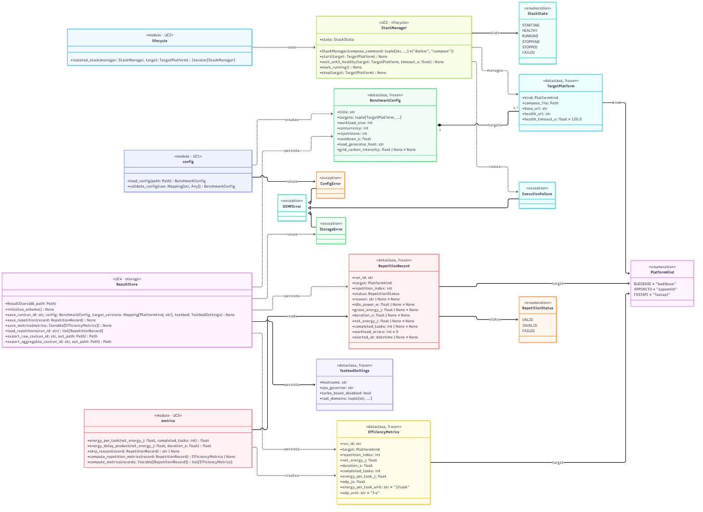

*Figure 2. Class diagram of the shared models and the UC1–UC4 interfaces.*

**UC1 — `gsmf/config.py`**

```python
def load_config(path: Path) -> BenchmarkConfig                    # raises ConfigError
def validate_config(raw: Mapping[str, Any]) -> BenchmarkConfig    # raises ConfigError
```

**UC2 — `gsmf/lifecycle.py`, `gsmf/health.py`**

```python
class StackManager:
    def __init__(self, compose_command: tuple[str, ...] = ("docker", "compose")) -> None
    runner                     # subprocess.run-compatible callable (injectable)
    command_timeout_s: float   # default 120.0
    @property
    def state(self) -> StackState
    def start(self, target: TargetPlatform) -> None
    def wait_until_healthy(self, target: TargetPlatform, timeout_s: float) -> None
    def mark_running(self) -> None
    def stop(self, target: TargetPlatform) -> None          # all raise ExecutionFailure

@contextmanager
def isolated_stack(manager: StackManager, target: TargetPlatform) -> Iterator[StackManager]

def http_status(url: str, timeout: float) -> int           # raises TimeoutError / OSError
```

**UC3 — `gsmf/metrics.py`**

```python
def energy_per_task(net_energy_j: float, completed_tasks: int) -> float
def energy_delay_product(net_energy_j: float, duration_s: float) -> float
def skip_reason(record: RepetitionRecord) -> str | None
def compute_repetition_metrics(record: RepetitionRecord) -> EfficiencyMetrics | None
def compute_metrics(records: Iterable[RepetitionRecord]) -> list[EfficiencyMetrics]
def load_records_csv(path: Path) -> list[RepetitionRecord]
def format_table(records: Sequence[RepetitionRecord], edp_unit: str = UNIT_EDP) -> str
def main(argv: Sequence[str] | None = None) -> int
```

**UC4 — `gsmf/storage.py`**

```python
class ResultStore:
    def __init__(self, db_path: Path) -> None
    def initialize_schema(self) -> None
    def save_run(self, run_id: str, config: BenchmarkConfig,
                 target_versions: Mapping[PlatformKind, str],
                 testbed: TestbedSettings) -> None
    def save_repetition(self, record: RepetitionRecord) -> None
    def save_metrics(self, metrics: Iterable[EfficiencyMetrics]) -> None
    def load_repetitions(self, run_id: str) -> list[RepetitionRecord]
    def export_raw_csv(self, run_id: str, out_path: Path) -> Path        # raw_<run_id>.csv
    def export_aggregates_csv(self, run_id: str, out_path: Path) -> Path # aggregates_<run_id>.csv
    # all raise StorageError
```

**Commands available now**

| Command | Purpose |
|---|---|
| `python -m gsmf.metrics examples/sample_measurements.csv` | UC3: print J/task and EDP per repetition, with skip reasons |
| `scripts/demo.ps1` (Windows) / `scripts/demo.sh` (Linux) | Run UC1–UC4 end to end (added for Assignment 3; UC2 is skipped when Docker is unavailable) |
| `python -m pytest -q` | Run the automated test suite |
| `python comparisons/config_manual_vs_pydantic.py --iterations 1000 --repeats 5` | UC1 technology comparison |
| `python comparisons/lifecycle_subprocess_vs_docker_sdk.py --repetitions 3` | UC2 technology comparison (needs Docker and the built baseline image) |
| `python comparisons/storage_sqlite_vs_csv_json.py --records 5000 --repeats 5` | UC4 technology comparison |

UC1, UC2 and UC4 are used as library calls (examples in the [README](../README.md)). The `gsmf run` and `gsmf export` commands shown in the wireframes are planned and do not exist yet.

### 2.4 Visual Interfaces

GSMF is CLI-first, so three of the four wireframes are terminal screens. Placeholders such as `x.xx`, `n` and `RUN_ID` are not measurements. The error texts in Wireframes 1 and 3 are copied from the current `ConfigError` and `StorageError` messages. Sources and SVGs are in [docs/wireframes/](wireframes/README.md).

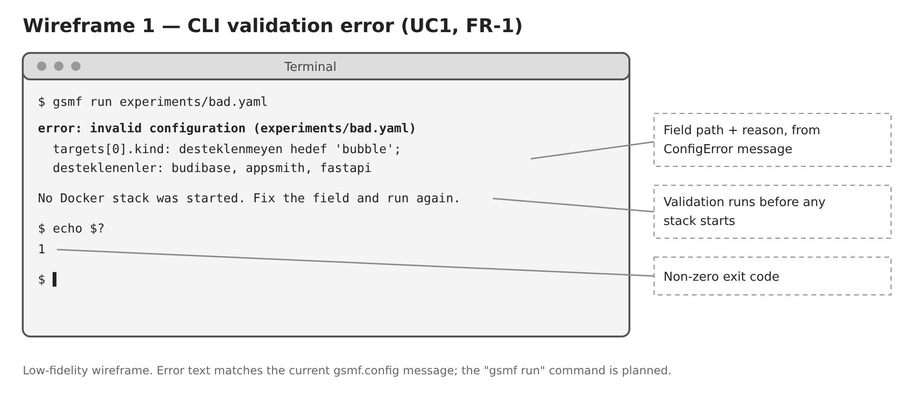

*Figure 3. UC1: an invalid configuration is rejected with the field path, before any stack starts, and with a non-zero exit code.*

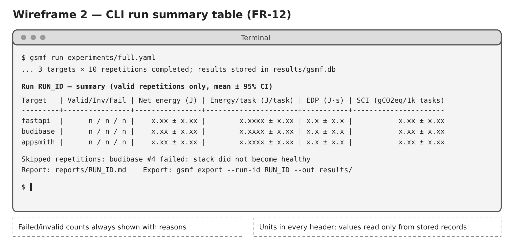

*Figure 4. Planned run summary (FR-12): valid/invalid/failed counts and units in every header.*

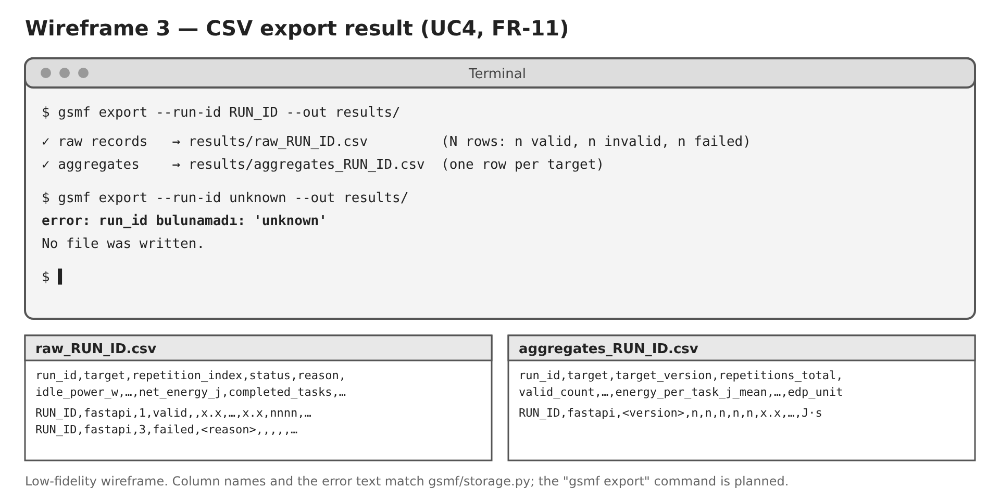

*Figure 5. UC4: export of raw records and aggregates, and the error for an unknown `run_id`.*

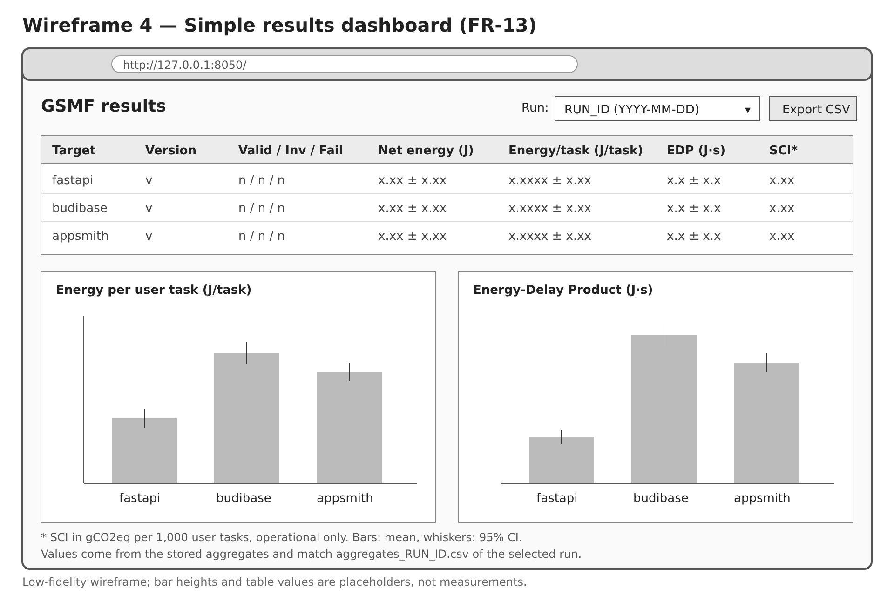

*Figure 6. Planned dashboard (FR-13): a run selector, a comparison table and J/task and EDP bar charts.*

<div style="page-break-after: always;"></div>

## 3 Use Case Support

### 3.1 Selection and Requirement Mapping

We selected four use cases that, taken together, cover the path of one benchmark result from input to stored output: a validated input (UC1), a controlled execution environment (UC2), the computed result (UC3) and its persistent record (UC4). Each use case can be implemented and tested without RAPL hardware or the k6 machine, so all four could be finished and verified this assignment. Each use case also matches one owner area in the [project plan](project-plan.md).

| Use case | Requirement | Module | Main interface | Tests |
|---|---|---|---|---|
| UC1 Configure benchmark | FR-1 Benchmark configuration | `gsmf/config.py` | `load_config`, `validate_config` | `test_config.py` |
| UC2 Manage isolated stack lifecycle | FR-3 Isolated stack lifecycle | `gsmf/lifecycle.py`, `gsmf/health.py` | `StackManager`, `isolated_stack` | `test_lifecycle.py`, `test_health_deadline.py` |
| UC3 Compute efficiency metrics | FR-8 Efficiency metrics | `gsmf/metrics.py` | `compute_metrics` | `test_metrics.py` |
| UC4 Persist and export results | FR-11 Result persistence and export | `gsmf/storage.py` | `ResultStore` | `test_storage.py` |

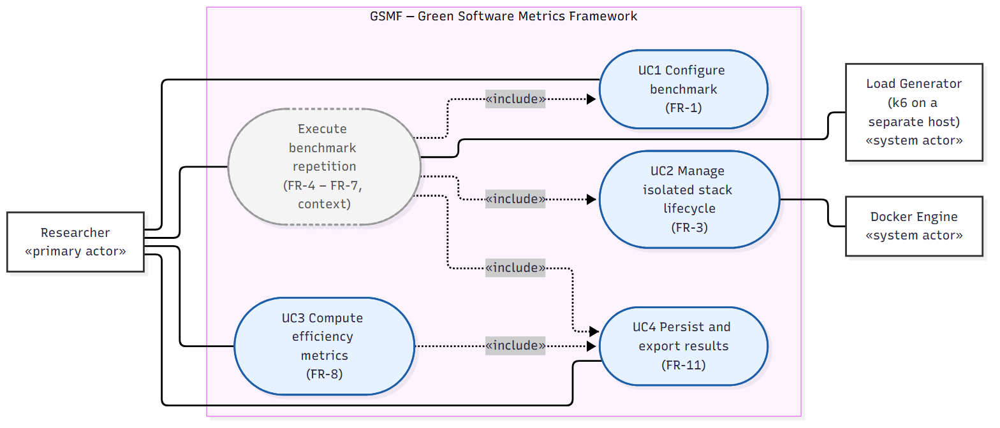

*Figure 7. Use case diagram. The grey use case (FR-4 – FR-7) is context only.*

### 3.2 UC1 — Configure Benchmark (FR-1)

**Architecture support.** `config` is a service module with no dependency on Docker or storage, so validation can run, and fail, before anything else starts. It is the only place that creates a `BenchmarkConfig`, so other modules can rely on receiving an already validated object.

**Data flow.** YAML file → `yaml.safe_load` → `Mapping[str, Any]` → `validate_config` (field rules in order) → `BenchmarkConfig` with a tuple of `TargetPlatform` → `load_config` resolves relative Compose paths → returned to the caller. On any violation, a `ConfigError` with the field path goes back to the caller and no further step runs.

**State changes.** None. UC1 has no state; it either returns a new immutable object or raises.

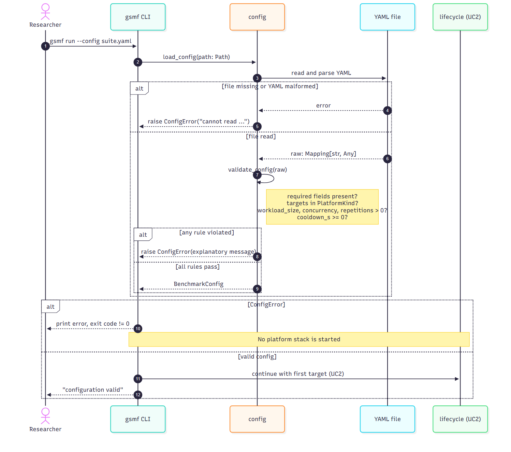

*Figure 8. UC1 sequence diagram.*

### 3.3 UC2 — Manage Isolated Stack Lifecycle (FR-3)

**Architecture support.** `lifecycle` is the only module that talks to Docker. One `StackManager` instance owns at most one target, which enforces the FR-3 rule "never start the next target before shutdown is confirmed" in code instead of by convention. Because the command runner is injectable, the state machine is tested without Docker.

**Data flow.** `TargetPlatform` → `docker compose -f <compose_file> up -d` → container states from `ps --all --format json` → HTTP status from `http_status(health_url)` → state `HEALTHY` → `mark_running()` → workload (planned) → `down --remove-orphans` → `ps --all --quiet` must be empty → state `STOPPED`. Command, health and shutdown errors become `ExecutionFailure`.

**State changes.** `STOPPED → STARTING → HEALTHY → RUNNING → STOPPING → STOPPED`. A Compose error, a container that exits or becomes unhealthy, or the health deadline passing leads to `FAILED`. A failed shutdown also leaves the manager in `FAILED` with the target still owned, so any new `start` is refused until `stop` succeeds on the original target.

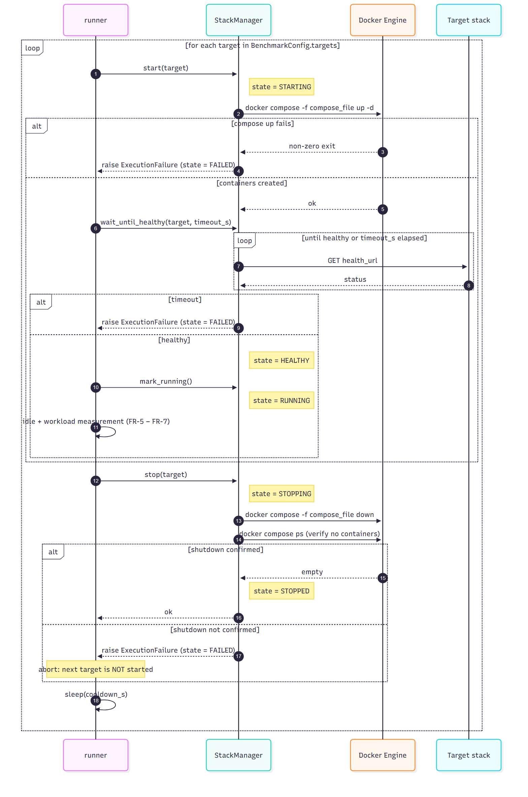

*Figure 9. UC2 sequence diagram.*

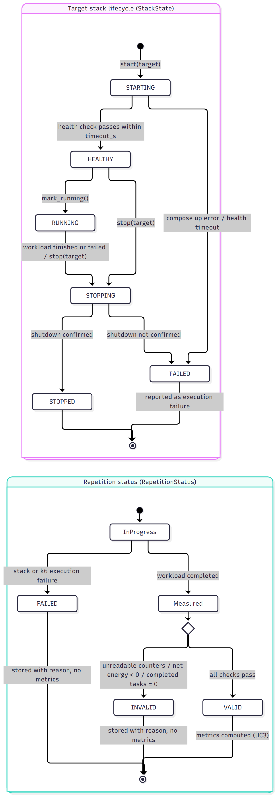

*Figure 10. State machines for the target stack (`StackState`, UC2) and for a repetition (`RepetitionStatus`, used by UC3 and UC4).*

### 3.4 UC3 — Compute Efficiency Metrics (FR-8)

**Architecture support.** `metrics` consists of pure functions over the shared `RepetitionRecord`. It does not read RAPL or the database itself, so it works the same on stored records, on records from the planned runner, and on CSV files (`load_records_csv`). The CSV columns are the same as the first columns of UC4's raw export, so an exported run can be read back into UC3.

**Data flow.** `list[RepetitionRecord]` → for each record, `skip_reason` → valid: `energy_per_task` and `energy_delay_product` → new `EfficiencyMetrics` (units `J/task`, `J·s`) → `list[EfficiencyMetrics]` in input order → optionally `ResultStore.save_metrics`. Skipped records produce no metric; `format_table` shows their reason.

**State changes.** UC3 does not change any state. It only reads `RepetitionStatus`: metrics are computed only for `VALID`, and `INVALID`/`FAILED` records are skipped (Figure 10, lower part).

With the illustrative sample file, 6 of 9 repetitions get metrics. For example, FastAPI repetition 1 gives 418.0 J / 1000 tasks = 0.418 J/task and 418.0 J × 18.1 s = 7,565.8 J·s; the failed, zero-task and negative-net-energy repetitions are skipped with their reasons.

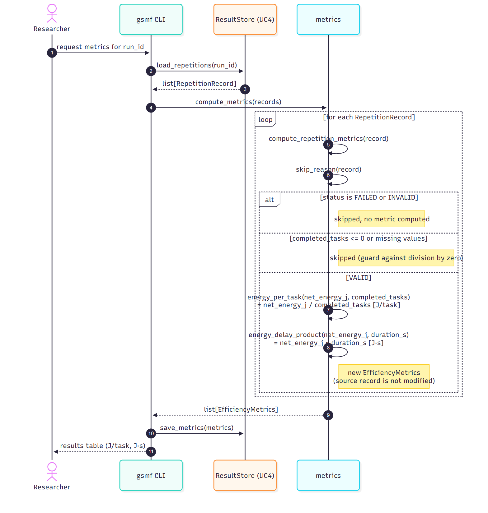

*Figure 11. UC3 sequence diagram.*

### 3.5 UC4 — Persist and Export Results (FR-11)

**Architecture support.** `storage` is the only module that knows about SQLite. Since FR-11 requires that stored values never change, the rule is enforced in three places: the API only offers insert methods, the schema has `UNIQUE` and `CHECK` constraints, and triggers abort every `UPDATE` and `DELETE`. Computed metrics go into their own table, so raw measurements are never overwritten by calculations.

**Data flow.** `save_run(run_id, BenchmarkConfig, target versions, TestbedSettings)` → `runs` + `run_targets`; `save_repetition(RepetitionRecord)` → `repetitions` (also failed/invalid with reason); `save_metrics(EfficiencyMetrics)` → `metrics` after cross-checking the stored repetition; `export_raw_csv` → `raw_<run_id>.csv`; `export_aggregates_csv` → `aggregates_<run_id>.csv`. An unknown `run_id` raises `StorageError: run_id bulunamadı: …` and no file is written.

**State changes.** Rows move only from "not stored" to "stored"; there is no update or delete path. The repetition status is stored as given and never recomputed.

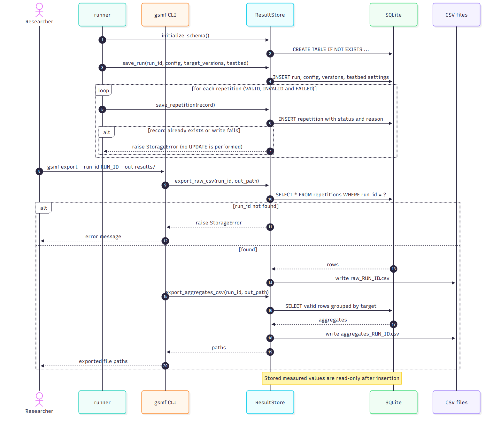

*Figure 12. UC4 sequence diagram.*

### 3.6 One Full Repetition

The activity diagram shows how the four use cases are connected in one benchmark repetition once the planned runner exists. UC2 frames the repetition, the planned measurement and workload steps decide the status, UC3 runs only for `VALID`, and UC4 stores every outcome before the stack is stopped and the cooldown starts.

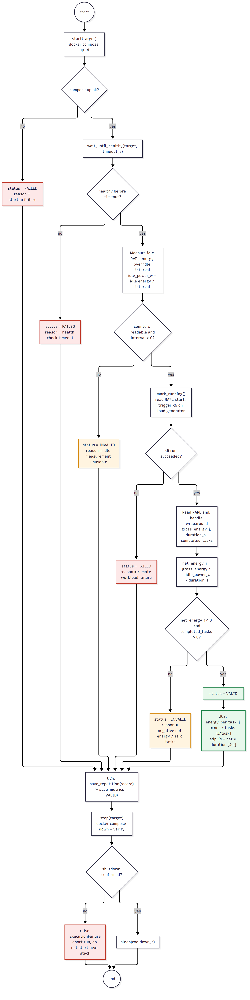

*Figure 13. Activity diagram of one benchmark repetition.*

<div style="page-break-after: always;"></div>

## 4 Design Decisions

### 4.1 Technology Comparisons

Each comparison is a committed script with its raw output in [comparisons/results/](../comparisons/results/). All three were run on synthetic input or the demo baseline; none of them are energy measurements or a general speed ranking.

#### 4.1.1 UC1 — Manual validation vs Pydantic

Script: [`comparisons/config_manual_vs_pydantic.py`](../comparisons/config_manual_vs_pydantic.py). Output: [`config-2026-11-15.jsonl`](../comparisons/results/config-2026-11-15.jsonl) (Python 3.12.14, Linux x86_64, Pydantic 2.13.4).

| Criterion | Manual (`gsmf/config.py`) | Pydantic schema + dataclass conversion |
|---|---|---|
| 62 synthetic cases matching expected accept/reject | 62 / 62 | 62 / 62 |
| Mismatches between the two | 0 | 0 |
| Median time per 1,000 valid-input validations (5 repeats) | 0.005993 s | 0.006514 s |
| Error reporting | stops at the first error | can collect several errors |
| Extra dependency | none | `pydantic` |

**Decision: keep manual validation.** Both rejected exactly the same inputs, and the time difference is negligible for a file that is read once per benchmark. Pydantic needed explicit validators to keep the strict FR-1 rules (no booleans as counts, finite numbers, URL/path checks), so it did not make the rules shorter. Keeping it manual avoids a runtime dependency and keeps the field-path error messages shown in Wireframe 1.

#### 4.1.2 UC2 — Docker Compose CLI via subprocess vs Docker SDK

Script: [`comparisons/lifecycle_subprocess_vs_docker_sdk.py`](../comparisons/lifecycle_subprocess_vs_docker_sdk.py). Output: [`lifecycle-2026-11-15.jsonl`](../comparisons/results/lifecycle-2026-11-15.jsonl) (macOS ARM64, Python 3.14.5, Docker Engine 29.4.3, Compose 5.1.4, Docker SDK 7.2.0). Both paths started the same prebuilt FastAPI image, waited for the same health endpoint and confirmed shutdown; all 6 runs reported `status=ok` and `shutdown_confirmed=true`.

| Repetition | subprocess / Compose total (s) | Docker SDK total (s) |
|---|---:|---:|
| 1 | 6.179146 | 5.716658 |
| 2 | 6.172350 | 5.720124 |
| 3 | 6.183902 | 5.770919 |

Most of each run is health waiting (about 5.2–5.3 s in both). The SDK was about 0.4–0.5 s faster per lifecycle on this machine. This snapshot was recorded before the total HTTP timeout fix (`2c01fc7`), so it does not include the cost of the child-process health probe.

**Decision: keep Compose via subprocess.** Budibase and Appsmith are multi-service stacks that are distributed as Compose files. The SDK path in the comparison works only because the baseline is a single container; using the SDK for the real targets would mean re-implementing their Compose files in Python. Half a second per stack start is not significant next to a measured workload repetition, and Compose also gives one command to remove the whole project (`down --remove-orphans`) and to verify that nothing is left (`ps --all --quiet`).

#### 4.1.3 UC4 — SQLite vs CSV vs JSON Lines

Script: [`comparisons/storage_sqlite_vs_csv_json.py`](../comparisons/storage_sqlite_vs_csv_json.py). Output: [`storage-2026-11-15.jsonl`](../comparisons/results/storage-2026-11-15.jsonl) (Linux x86_64, Python 3.13.18, SQLite 3.53.1; 5,000 synthetic records: 4,692 valid, 49 invalid, 259 failed; medians of 5 runs).

| Format | Write (s) | Read (s) | Size (bytes) | Round trip equal | `started_at` kept | Duplicate append | Edit stored value |
|---|---:|---:|---:|---|---|---|---|
| SQLite (`ResultStore`) | 5.966098 | 0.017424 | 737,280 | yes | yes | rejected | rejected by trigger |
| CSV | 0.046329 | 0.027063 | 673,399 | yes | no | appended | changed |
| JSON Lines | 0.065257 | 0.030254 | 1,682,823 | yes | yes | appended | changed |

**Decision: SQLite for storage, CSV for export.** SQLite was the slowest to write because `ResultStore` commits each record in its own transaction, which is about 1.2 ms per record here. One repetition takes a full workload run, so this cost is irrelevant. SQLite was the only format that rejected a duplicate record and an edit to a stored value by itself, which is exactly what FR-11 requires. It also read fastest. CSV is kept as the export format because FR-11 asks for CSV and it opens in any spreadsheet tool.

### 4.2 Justification of Choices

| Choice | Justification |
|---|---|
| **Python** | The concept notes and project plan fix Python 3.11 for the CLI. It reads RAPL sysfs files and starts external processes with the standard library alone (`pathlib`, `subprocess`), has `sqlite3` and `csv` built in, and the FastAPI baseline uses the same language. Two of the four use cases (UC3, UC4) need no third-party package at all. |
| **SQLite** | No server to install on the testbed (NFR-8, zero cost), one file per database that can be copied with the results, transactions, constraints and triggers that enforce FR-11's "never modify stored values", and the comparison results in §4.1.3. |
| **Docker Compose via `subprocess`** | The low-code targets are already defined as Compose files; argument-list calls with no shell and a finite timeout are simple to inject in tests; and Compose can remove and verify a whole multi-service project (§4.1.2). |
| **YAML configuration** | FR-1 specifies YAML. It is readable for researchers, supports comments (used in `examples/benchmark.yaml`), and maps directly to a dictionary that `validate_config` checks. `yaml.safe_load` is used so a config file cannot construct arbitrary Python objects. |
| **Layered architecture** | Each use case is one service module that depends only on `gsmf/models.py`, so four members could implement UC1–UC4 in parallel against the stubs committed in `8c234f0` without merge conflicts. External systems (Docker, SQLite, files) sit in the bottom layer, so the core logic can be tested without them; the planned runner and dashboard can be added on top without changing UC1–UC4. |
| **Frozen dataclasses** | Records cannot be changed in memory after measurement, matching FR-11's rule for stored data, and they are easy to compare in tests. |

<div style="page-break-after: always;"></div>

## 5 Task Matrix

The table lists the Assignment 2 work from `git log` (non-merge commits since 2 November 2026) and the assignments in [qa-plan.md §5](qa-plan.md#5-task-matrix) and the [project plan](project-plan.md). Work done with an AI assistant is listed under the member who directed it and marked "AI-assisted". Some of those commits were recorded under the assistant identities `Claude` and `Codex` or carry a `Co-Authored-By: Claude` trailer; they are listed as evidence in the directing member's row.

| Member | Assignment 2 contribution | Evidence |
|---|---|---|
| Reşat Efe Koca (@djkurbaga) | Shared data models and interface stubs; UML use case, component, class, four sequence, state and activity diagrams with the diagram index; UC3 metrics implementation, tests and demo data; this design document. Commits made with assistant support (`Co-Authored-By: Claude` trailer). | 8 commits as "Reşat efe": `8c234f0`, `d8abe31`, `fdf8a6b`, `7b5ed53`, `4758763`, `ccb5886`, `84353bd`, `45b44ed`; branch `docs/design-document` |
| Murat Yılmaz (@yilmazmurat06) | UC1 configuration loader and tests, example config; UC2 lifecycle manager and tests; HTTP health deadline; FastAPI baseline app, Dockerfile and Compose file; Compose vs Docker SDK comparison and its recorded output. | 18 commits as "Murat Yılmaz" (`[config]`, `[lifecycle]`, `[baseline]`, `[comparison]`), branches `feature/uc1-config`, `feature/uc2-lifecycle` |
| Bülent Çakır (@BulentCakirr) | UC4 SQLite result store (FR-11), its tests, the SQLite vs CSV vs JSON Lines storage comparison, the wireframes and the UC4 README section (AI-assisted, recorded under the assistant identity `Claude`); Windows path-separator and SQLite connection-closing fix with a regression test; FR numbering in the project plan task matrix (§11.1); this task matrix update. | 6 AI-assisted commits as `Claude` on `feature/uc4-storage` (`1bd60d1`, `55a7aee`, `df8385f`, `52aad4b`, `458f1a1`, `dace608`); commits as "Bülent Çakır" (`ba5dc95`, `14b211f`, `68d58ac` and `d58be8b`) |
| Furkan Yaman (@furkany22) | First draft of the UML use case and activity diagrams (now replaced by `docs/diagrams/`); QA plan, bug report template and manual vs Pydantic config comparison (AI-assisted, recorded under the assistant identity `Codex`). | 1 commit as "furkany22" (`2e309f4`); 2 AI-assisted commits as `Codex` on `docs/qa-plan` (`b75b5cd`, `c6b189c`) |