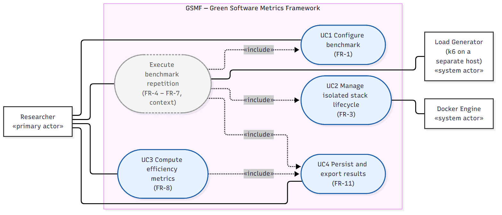
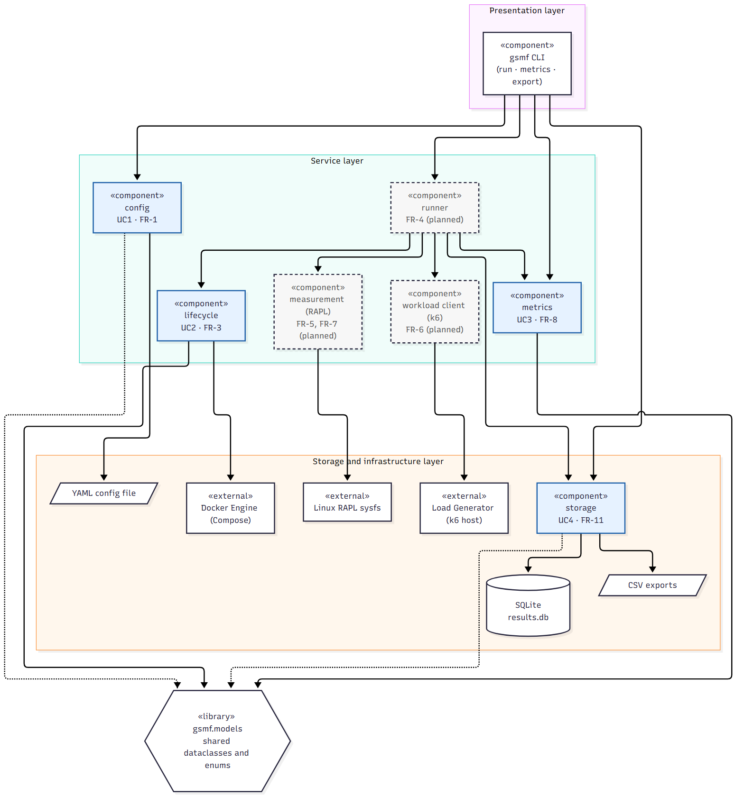
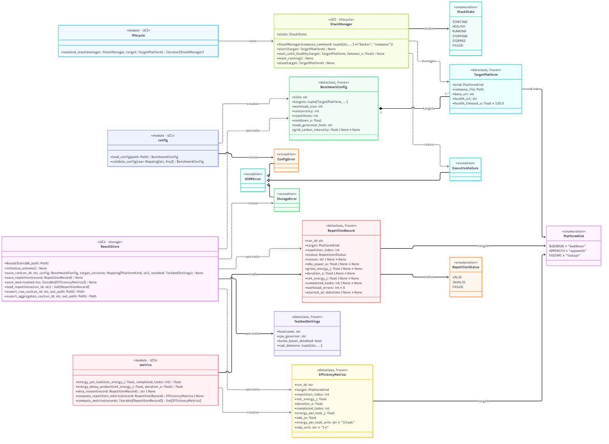
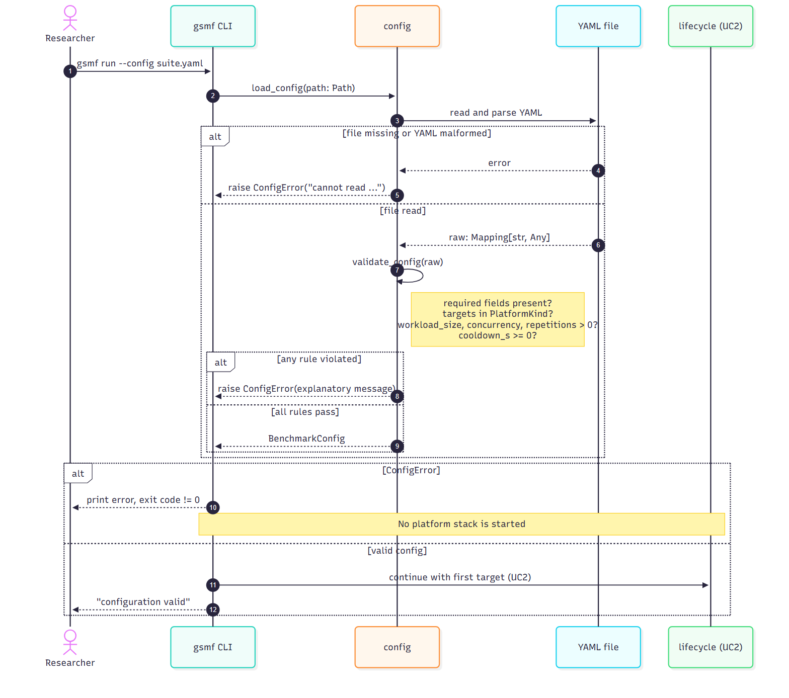
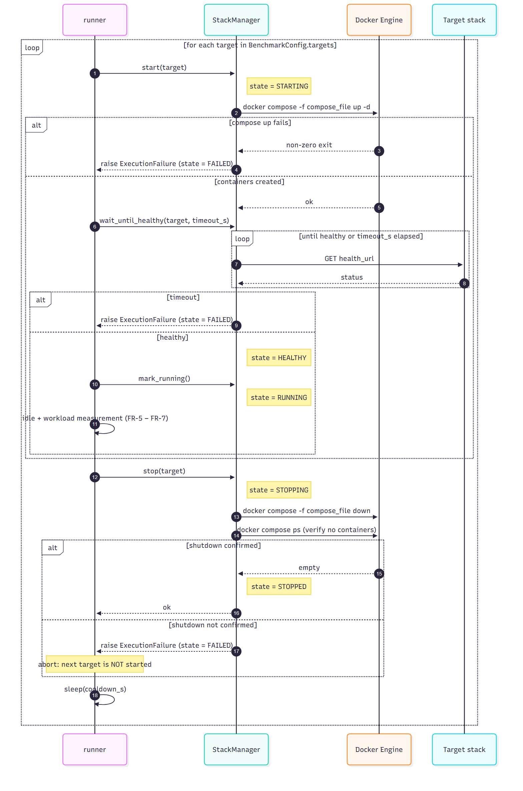
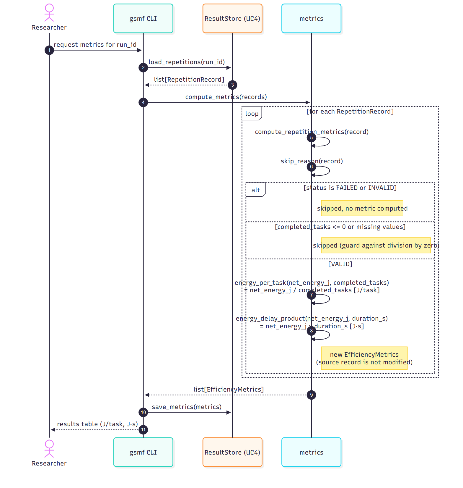
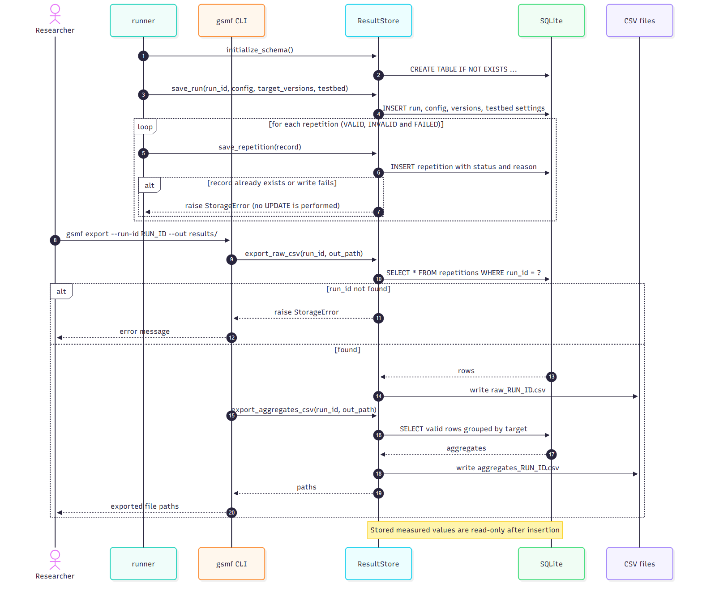
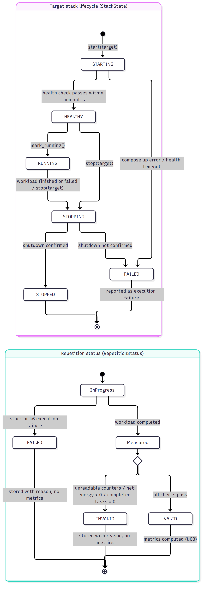
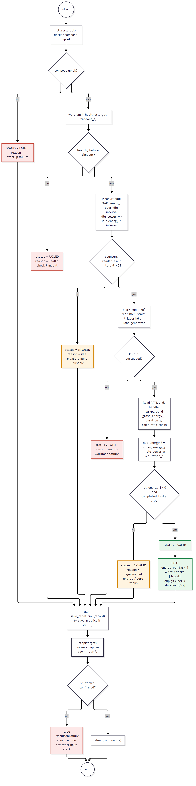

# GSMF UML Diagrams

UML diagrams for the four selected use cases of GSMF:

| Use case | Requirement | Title |
|---|---|---|
| UC1 | FR-1 | Configure benchmark |
| UC2 | FR-3 | Manage isolated stack lifecycle |
| UC3 | FR-8 | Compute efficiency metrics |
| UC4 | FR-11 | Persist and export results |

Each diagram has a Mermaid source (`.mmd`) and an exported PNG. The class diagram mirrors the exact signatures in [`gsmf/models.py`](../../gsmf/models.py) and the interface stubs [`gsmf/config.py`](../../gsmf/config.py), [`gsmf/lifecycle.py`](../../gsmf/lifecycle.py), [`gsmf/storage.py`](../../gsmf/storage.py) (plus `gsmf/metrics.py` for UC3).

To regenerate a PNG after editing a source:

```bash
npx -y @mermaid-js/mermaid-cli -i docs/diagrams/<name>.mmd -o docs/diagrams/<name>.png -b white -s 2
```

## Diagram index

| Diagram | Source | Description |
|---|---|---|
| Use case | [use-case.mmd](use-case.mmd) | Actors (Researcher, Docker Engine, Load Generator) and UC1–UC4 inside the GSMF boundary. |
| Component | [component.mmd](component.mmd) | Layered architecture: CLI → service components → storage and infrastructure. |
| Class | [class.mmd](class.mmd) | Shared dataclasses, enums, exceptions and the interface stubs with exact signatures. |
| Sequence — UC1 | [sequence-uc1-configure.mmd](sequence-uc1-configure.mmd) | Loading and validating the YAML config; invalid input is rejected before any stack starts. |
| Sequence — UC2 | [sequence-uc2-lifecycle.mmd](sequence-uc2-lifecycle.mmd) | Compose up, health check with timeout, stop with confirmed shutdown, one stack at a time. |
| Sequence — UC3 | [sequence-uc3-metrics.mmd](sequence-uc3-metrics.mmd) | Energy per task and EDP for valid repetitions only; failed/invalid/zero-task records skipped. |
| Sequence — UC4 | [sequence-uc4-persist.mmd](sequence-uc4-persist.mmd) | Insert-only persistence of runs and repetitions in SQLite and CSV export of raw and aggregate data. |
| State machine | [state.mmd](state.mmd) | Target stack states (starting → healthy → running → stopping → stopped / failed) and repetition status (valid / invalid / failed). |
| Activity | [activity.mmd](activity.mmd) | One full benchmark repetition from stack start to cooldown, including every failure/invalid branch. |

## Use case diagram

Mermaid has no native use-case diagram type, so it is drawn as a flowchart: rounded nodes are use cases, rectangles are actors and dotted arrows are `«include»` relations. The grey dashed use case (FR-4 – FR-7) is shown only as context; it is outside the four selected use cases.



## Component diagram

Blue components implement UC1–UC4; dashed grey components are planned (FR-4 – FR-7) and are not part of this assignment.



## Class diagram



## Sequence diagram — UC1 Configure benchmark



## Sequence diagram — UC2 Manage isolated stack lifecycle



## Sequence diagram — UC3 Compute efficiency metrics



## Sequence diagram — UC4 Persist and export results



## State machine diagram



## Activity diagram — one benchmark repetition


