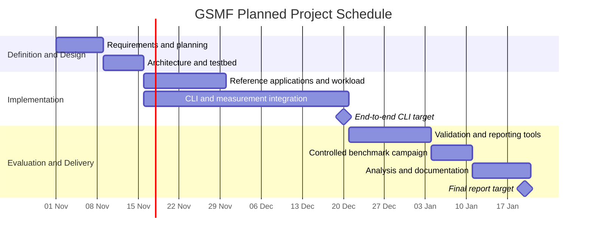

# Project Plan Document

**Project:** Green Software Metrics Framework (GSMF)
**Course:** BIL 481 Software Engineering, Fall 2026
**Group:** Intellectual Property
**Document date:** 01-11-2026

**Contributors to this document:**

|Name|GitHub|School Number|
|-|-|-|
|Reşat Efe Koca|@djkurbaga|231301010|
|Bülent Çakır|@BulentCakirr|231301064|
|Murat Yılmaz|@yilmazmurat06|241101063|
|Furkan Yaman|@furkany22|221301015|

\---

## Table of Contents

1. [Project Scope](#1-project-scope)
2. [Project Organization](#2-project-organization)
3. [Objectives](#3-objectives)
4. [Key Phases and Timeline](#4-key-phases-and-timeline)
5. [Resource Planning](#5-resource-planning)
6. [Risk Management](#6-risk-management)
7. [Communication Plan](#7-communication-plan)
8. [Change Management Plan](#8-change-management-plan)
9. [Budget Plan](#9-budget-plan)
10. [Effort Estimation](#10-effort-estimation)
11. [Task Assignments](#11-task-assignments)
12. [Document-Specific Task Matrix](#12-document-specific-task-matrix)

\---

## 1\. Project Scope

**Included:** a Python CLI framework that benchmarks the same reference CRUD application on self-hosted Budibase and Appsmith (Docker) and a hand-coded FastAPI baseline; RAPL-based energy measurement with idle baseline subtraction; remote k6 workload; repeated trials under controlled CPU settings; statistics, EDP and operational SCI; SQLite storage, CSV/Markdown reports and a simple web dashboard.

**Not included:** vendor-hosted SaaS low-code platforms, browser/frontend energy measurement, embodied carbon (M), network-to-energy conversion, Kubernetes deployments and external hardware power meters.

## 2\. Project Organization

|Member|Main Role|Responsibilities|
|-|-|-|
|Reşat Efe Koca|Project Manager, Measurement Engineer|Planning and tracking, testbed setup, RAPL reader, net energy, statistics and SCI module|
|Bülent Çakır|Requirements Analyst, Documentation Lead|Requirements, Budibase reference app, storage/CSV export and reports, document consistency|
|Murat Yılmaz|Lead Developer|Architecture, CLI runner and Docker lifecycle, FastAPI baseline, dashboard|
|Furkan Yaman|Test Engineer|Appsmith reference app, k6 workload scripts, testing, benchmark validation|

## 3\. Objectives

1. Deliver all assignment documents and the final product on the course deadlines.
2. Complete a working end-to-end measurement pipeline (CLI) by 20 December 2026, before adding optional features.
3. Keep the work visible on GitHub: every task is a GitHub Issue, and every member commits their own work with clear messages.
4. Hold weekly progress meetings and keep the schedule within one week of the plan.
5. Collect at least 10 valid repetitions per platform and finish the final report by 20 January 2027.

## 4\. Key Phases and Timeline

The schedule below is a planning baseline aligned with the existing objectives: an end-to-end CLI pipeline by **20 December 2026** and the comparative report by **20 January 2027**. Intermediate dates are planned targets; assignment submission and presentation dates remain subject to the course schedule.

|Phase|Planned Dates|Dependencies|Completion Milestone|
|-|-|-|-|
|**P1 — Requirements and planning**|1–8 November 2026|Initial project definition|Scope, requirements and responsibilities reviewed; implementation tasks tracked as GitHub Issues.|
|**P2 — Architecture and testbed preparation**|9–15 November 2026|P1|Module interfaces, configuration and result-record structure agreed; Docker, RAPL and remote k6 feasibility demonstrated.|
|**P3 — Reference applications and workload**|16–29 November 2026|P2|Three applications implement the same user-task semantics; common datasets and k6 workload pass functional checks.|
|**P4 — CLI and measurement integration**|16 November–20 December 2026|P2; P3 required for final integration|CLI completes stack startup, idle measurement, remote workload, energy calculation, result storage and cleanup for all three targets.|
|**P5 — Validation and reporting tools**|21 December 2026–3 January 2027|P3, P4|Pilot runs validate measurements and failure handling; statistical outputs, exports and dashboard are ready.|
|**P6 — Controlled benchmark campaign**|4–10 January 2027|P5|At least 10 valid repetitions per platform collected with recorded configurations and experimental conditions.|
|**P7 — Analysis and final delivery preparation**|11–20 January 2027|P6|Comparative report, reproducibility instructions, final documentation and presentation material completed.|

Gantt bars use the following day as the exclusive end date to match the inclusive date ranges in the table. Progress is assessed against the completion milestones during weekly meetings. Delays affecting the measurement pipeline take priority over dashboard enhancements; failed experimental runs are repeated before the final dataset is accepted.

## 5\. Resource Planning

Resource allocation follows the project organization in Section 2. Availability and testbed compatibility must be confirmed during P2 before the benchmark campaign is scheduled.

|Resource|Planned Allocation and Use|Responsible Member(s)|
|-|-|-|
|**Development and integration**|Architecture, Python CLI, Docker lifecycle, FastAPI baseline and dashboard implementation.|Murat Yılmaz|
|**Measurement and analysis**|Testbed preparation, RAPL reader, baseline correction, statistics and SCI calculations.|Reşat Efe Koca|
|**Requirements and data reporting**|Requirements coordination, Budibase application, SQLite storage, CSV export and reports.|Bülent Çakır|
|**Workload and validation**|Appsmith application, k6 scripts, functional testing and benchmark validation.|Furkan Yaman|
|**Dedicated Linux testbed**|A RAPL-capable machine with sufficient CPU, memory and disk for the largest individual stack. Reserve exclusive benchmark windows, document CPU settings and prevent competing benchmark jobs.|Reşat Efe Koca; Murat Yılmaz for stack integration|
|**Separate load-generator machine**|Run k6 against the testbed over a stable network connection. Verify in pilot runs that generator capacity does not limit the selected workload.|Furkan Yaman|
|**Development toolchain**|Python, Docker Compose, k6, Git and the application dependencies. Record dependency and container versions with reproducible setup instructions.|All members within their implementation areas|
|**Repository and experiment storage**|GitHub for source, issues and reviews; SQLite and CSV for results. Preserve raw records, configurations and environment metadata for each benchmark campaign.|Bülent Çakır; all members contribute their artifacts|
|**Carbon-intensity input**|A documented grid carbon-intensity value with units, source and applicable region/time assumptions for operational SCI calculations.|Reşat Efe Koca|

Implementation can proceed in parallel after interfaces and result formats are agreed. Shared-testbed access is coordinated through the weekly plan, with controlled measurements taking precedence over interactive development. Resource shortages are recorded as project issues and assessed against the milestones before additional scope is accepted.

## 6\. Risk Management

Risks are reviewed weekly and before the controlled benchmark campaign. Likelihood and impact are qualitative planning estimates (Low, Medium or High). Each owner tracks warning signs and mitigation actions in GitHub Issues; unresolved risks that threaten a milestone are raised with the project manager.

|ID|Risk and Consequence|Likelihood / Impact|Prevention and Response|Owner|
|-|-|-|-|-|
|**R1**|RAPL counters or required CPU controls are unavailable, preventing valid measurements.|Medium / High|Verify access and CPU settings during P2. If checks fail, secure a compatible Linux testbed before continuing measurement work; do not substitute unsupported energy estimates.|Reşat Efe Koca|
|**R2**|Background activity or thermal variation increases measurement noise and weakens comparisons.|High / High|Reserve exclusive testbed windows, fix CPU settings, use cooldowns and record idle baselines. Investigate unstable pilot results and repeat invalid runs under documented conditions.|Reşat Efe Koca|
|**R3**|Platform differences cause unequal task semantics, making benchmark results incomparable.|Medium / High|Agree on common data, task definitions and completion checks before implementation. Validate all three applications against the same workload and correct mismatches before the campaign.|Furkan Yaman|
|**R4**|Docker startup, health checks or cleanup fail, blocking the runner or allowing overlapping stacks.|Medium / High|Use startup timeouts, health checks and verified shutdown. Preserve failure logs and stop progression when cleanup cannot be confirmed.|Murat Yılmaz|
|**R5**|Load-generator saturation or network instability distorts workload timing.|Medium / High|Check generator capacity and connectivity during pilots. Record workload errors, invalidate affected runs and rerun after resolving the limiting condition.|Furkan Yaman|
|**R6**|Integration delays threaten the 20 December pipeline milestone.|Medium / High|Agree on module interfaces in P2 and integrate incrementally. Prioritize the end-to-end measurement path and defer dashboard enhancements if the milestone is at risk.|Murat Yılmaz|
|**R7**|Missing raw data, configuration or version metadata prevents reproducibility.|Medium / High|Persist per-run records and metadata, retain failed runs with status, and check exports during pilots. Recover from retained copies or repeat runs whose evidence is incomplete.|Bülent Çakır|
|**R8**|Incorrect units or unsupported carbon-intensity assumptions produce misleading SCI results.|Medium / Medium|Review unit conversions and document the carbon-intensity source and measurement boundary. Correct calculations and regenerate derived results when assumptions change.|Reşat Efe Koca|

## 7\. Communication Plan

Communication is organized so that progress, blockers and decisions are visible to all members and traceable in the repository.

|Channel|Purpose|Frequency|Owner / Participants|
|-|-|-|-|
|**Weekly meeting**|Review progress against milestones, risks (Section 6), blockers and next tasks.|Every Monday, 30 minutes|Project manager leads; all members|
|**Messaging group (WhatsApp)**|Quick questions, testbed booking and short coordination.|As needed|All members|
|**GitHub Issues and Projects board**|Task tracking with owner, due date and status; decisions and risks recorded in issues.|Continuous|Each task owner; project manager monitors|
|**Pull Request reviews**|Review code and document changes before merging.|For every change|Author plus at least one reviewer|
|**Phase milestone review**|Confirm completion criteria of each phase (Section 4) before the next phase starts.|End of each phase|All members|
|**Instructor and TA**|Questions about requirements, deliverables and grading.|As needed (Piazza or office hours)|Project manager collects and forwards questions|

**Escalation:** a blocker that lasts more than two days is labeled `blocked` in GitHub Issues and announced in the messaging group. Issues that threaten a milestone are raised with the project manager and discussed at the next meeting, or in an extra short meeting if the milestone is within one week.

## 8\. Change Management Plan

Changes are classified by their effect on scope, schedule and measurement validity.

|Change Type|Examples|Approval|
|-|-|-|
|**Minor**|Wording fixes, refactoring inside one module, small UI changes.|Module owner, through a reviewed Pull Request.|
|**Major**|New or removed requirements, scope changes, schedule changes, changes to the measurement method or workload.|Team decision at the weekly meeting.|

**Process for major changes:**

1. The requester opens a GitHub Issue labeled `change-request` with the description, reason and affected requirements.
2. The owner of the affected area assesses the impact on scope, effort, schedule and risks.
3. The team accepts, postpones or rejects the change at the weekly meeting; the project manager records the decision in the issue.
4. Accepted changes are applied to the Requirements and Project Plan documents and the code through linked Pull Requests.

**Measurement freeze:** during the controlled benchmark campaign (P6), the workload, configuration and container versions are frozen. Only critical fixes are allowed; any change that affects measurements invalidates the affected runs, which are repeated before the dataset is accepted.

## 9. Budget Plan

The project has no monetary cost; all software is free or open source and hardware is owned by the team. The main budget is team effort (392 person-hours in total, see Section 10), allocated as follows:

| Phase | Person-hours | Share |
|---|---|---|
| Requirements and planning | 40 | 10% |
| Design | 48 | 12% |
| Development | 192 | 49% |
| Testing and experiments | 56 | 14% |
| Documentation and deployment | 40 | 10% |
| Closure (presentation) | 16 | 4% |
| **Total** | **392** | **100%** |

## 10. Effort Estimation

**Method:** Bottom-up estimation with expert judgment and analogy. Each phase was broken into tasks, each task was estimated by the member most familiar with it (based on similar coursework projects), and the estimates were discussed and adjusted as a team.

### 10.1 Effort per Task

| Phase | Task | Person-hours | Owner |
|---|---|---|---|
| Requirements and planning | Project documents for Assignment 1 | 40 | All (Reşat 12, Bülent 16, Murat 6, Furkan 6) |
| Design | Architecture, app spec, experiment design | 48 | All (12 each) |
| Development | Testbed setup and RAPL reader | 24 | Reşat |
| Development | FastAPI reference app | 16 | Murat |
| Development | Budibase reference app | 24 | Bülent |
| Development | Appsmith reference app | 24 | Furkan |
| Development | k6 workload scripts | 16 | Furkan |
| Development | CLI runner and Docker lifecycle | 32 | Murat |
| Development | Statistics, EDP and SCI module | 16 | Reşat |
| Development | Storage, CSV export and reports | 16 | Bülent |
| Development | Web dashboard | 24 | Murat |
| Testing | Unit and integration tests | 24 | Bülent 12, Furkan 12 |
| Testing | Benchmark runs and validation | 32 | Reşat 16, Furkan 16 |
| Documentation | Final report, README, setup guide | 40 | All (10 each) |
| Closure | Presentation preparation | 16 | All (4 each) |

### 10.2 Effort per Person

| Member | Person-hours |
|---|---|
| Reşat Efe Koca | 94 |
| Bülent Çakır | 94 |
| Murat Yılmaz | 104 |
| Furkan Yaman | 100 |
| **Total project effort** | **392** |

## 11\. Task Assignments
### 11.1 Task Matrix (Phases and Functional Requirements)

|Item|Reşat|Bülent|Murat|Furkan|
|-|-|-|-|-|
|Requirements and planning|R|**A**|R|R|
|Design|**A**|R|R|R|
|FR-1 Configuration file|||**A**||
|FR-2 Reference application||R (Budibase)|**A** (FastAPI)|R (Appsmith)|
|FR-3 Docker stack lifecycle|||**A**||
|FR-4 Idle power measurement|**A**||||
|FR-5 Warm-up phase||||**A**|
|FR-6 Remote k6 workload and energy|R|||**A**|
|FR-7 Net energy, energy per task, EDP|**A**||||
|FR-8 Repetitions and cooldown|||**A**||
|FR-9 Statistics|**A**||||
|FR-10 Operational SCI|**A**||||
|FR-11 Storage and CSV export||**A**|||
|FR-12 Terminal summary and report||**A**|||
|FR-13 Dashboard|||**A**||
|FR-14 Scaphandre (optional)|**A**||||
|Testing and NFR verification|R|R||**A**|
|Documentation|R|**A**|R|R|

**A** = accountable owner, **R** = contributes.

### 11.2 Rationale for Task Assignment

Tasks were assigned by matching skills and interests: Reşat has embedded Linux and hardware experience, so he owns the RAPL and measurement parts and project management; Murat has the strongest backend experience, so he leads the CLI architecture and dashboard; Bülent focuses on requirements and documentation and builds the Budibase app to learn a low-code tool; Furkan owns testing and the k6 workload, which fits his interest in quality assurance. Each member also builds or tests part of a reference application so that everyone learns the low-code platforms. Total effort per person is within about 10% of the average (98 hours), which keeps the distribution fair.

### 11.3 Clarity of Contribution on GitHub

* Every member commits from their own GitHub account.
* Commit messages follow the format `\\\[area] short description` (e.g., `\\\[rapl] add idle power sampler`).
* Code is organized by module (`gsmf/measurement`, `gsmf/runner`, `gsmf/report`, `apps/`, `workload/`, `docs/`), so ownership matches folders.
* Each Issue and Pull Request is assigned to its owner.
## 12\. Document-Specific Task Matrix

|Task|Responsible|
|-|-|
|Scope, objectives and organization|Reşat Efe Koca|
|Timeline and Gantt chart|Murat Yılmaz|
|Resource planning and risk management|Murat Yılmaz|
|Communication and change management plans|Reşat Efe Koca|
|Budget plan and effort estimation|Furkan Yaman|
|Task matrix and rationale|Bülent Çakır|
|Review and final PDF|Bülent Çakır|

