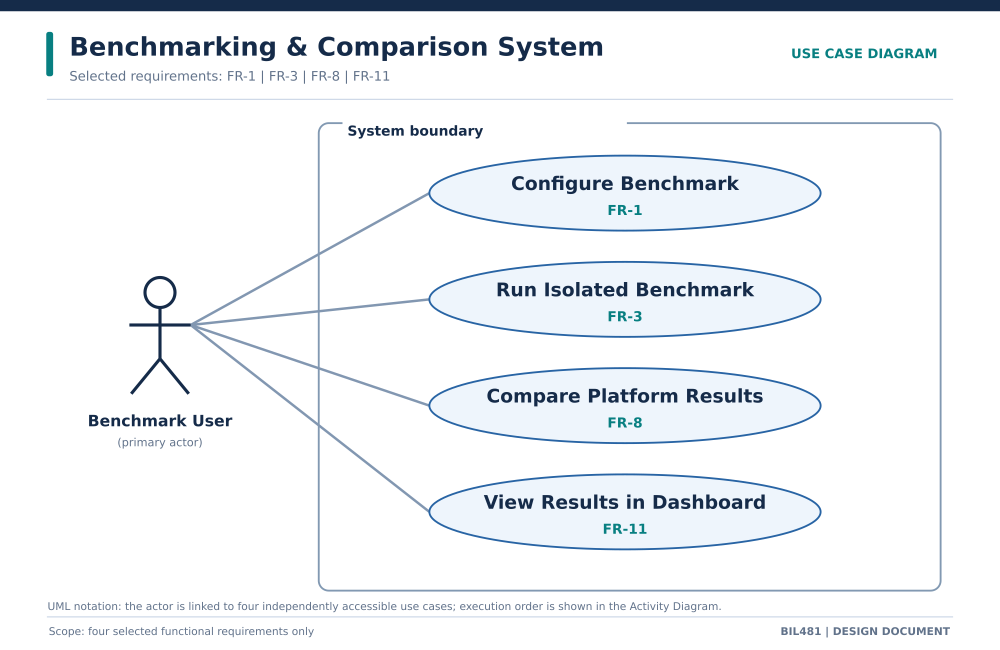
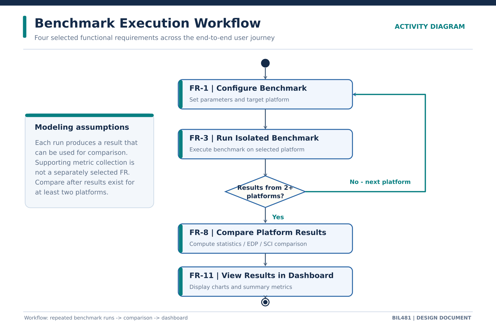

# UML Diagrams — Assignment 2

## Scope

The following diagrams document four selected functional requirements of the Benchmarking & Comparison System.

| Functional requirement | Use case | Description |
|---|---|---|
| FR-1 | UC1 | Configure Benchmark |
| FR-3 | UC2 | Run Isolated Benchmark |
| FR-8 | UC3 | Compare Platform Results |
| FR-11 | UC4 | View Results in Dashboard |

## Use Case Diagram

The primary actor, **Benchmark User**, interacts with four use cases within the system boundary. The diagram defines the selected functional scope; it does not represent execution order.

*Figure 1. UML Use Case Diagram — selected functional requirements.*

## Activity Diagram

The activity diagram illustrates the proposed user workflow: configure a benchmark, run it, collect platform results, compare results from multiple platforms, and view the outcome in the dashboard.

*Figure 2. UML Activity Diagram — proposed benchmarking workflow.*

> Note: The diagrams model the selected subset of requirements for Assignment 2. Verify the descriptions and any workflow assumptions against the project's requirements specification before final submission.
